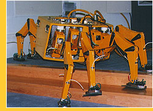
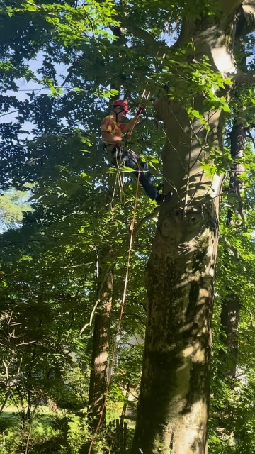

<!-- _class: lead -->
<!-- _paginate: false -->
<!-- _header: '' -->
<!-- _footer: '' -->

# Tech / AI Advancements for the Nature Around Us

### How Technology can improve our interactions with Nature

  <strong>Peter Sody</strong> - BarCamp Philly 17

<!-- Note: Welcome everyone. Today we are looking at how AI and modern technology enhance the nature around us through the complete 5-stage life cycle. We explicitly compare residential living spaces—where we live and interact daily—with commercial enterprise scale, keeping our primary spotlight on residential applications. -->

---

# About Me: The Background Leading to Tech/AI for Nature

  

    🇩🇪 Germany
    <ul style="font-size: 0.82em; margin-bottom: 10px;">
      <li>Growing up on a farm / winery.</li>
      <li>M.S., Computer Science.</li>
      <li>Robotics: Robug 3.</li>
      <li>AI Startup using constraint solver for staff scheduling.</li>
    </ul>
    

      
    

  

  

    🇺🇸 United States of America
    <ul style="font-size: 0.77em; margin-bottom: 8px;">
      <li>Software Engineer and Architect with a focus on software quality and DevOps.</li>
      <li>Principal Software Engineer: Leading initiatives spanning software quality, security, productivity, and AI adoption for 100 engineers / 15 teams supporting ca. 50 products.</li>
      <li>Gardening / growing vegetables.</li>
      <li>"Junior Arborist".</li>
    </ul>
    

      
    

  

  
---

# Residential vs. Commercial Applications

  

    🏡 The Residential Domain
    <h3>Our Intimate Everyday Nature</h3>
    <ul>
      <li><strong>Immediate Proximity:</strong> Most of of our personal interactions with biological life happen inside living rooms, patios, suburban yards, and domestic pets.</li>
      <li><strong>Accessible Bio-Intelligence:</strong> Computer vision and smartphone microphones bring enterprise-grade botany and ethology to every household.</li>
      <li><strong>Rewilding Suburbia:</strong> Collective residential yards represent millions of acres of potential pollinator corridors and micro-habitats.</li>
    </ul>
  

  

    🏢 Commercial Benchmark
    <h3>Scale & Macro Impact</h3>
    <ul>
      <li><strong>Broadacre Fields:</strong> Thousands of hectares demanding heavy autonomous tractors and satellite spectral passes.</li>
      <li><strong>Industrial Supply Chains:</strong> Economic efficiency, bulk food production, and planetary carbon/water footprints.</li>
      <li><strong>The Technology Transfer:</strong> Commercial agricultural tech (lasers, sensors, CV) is influencing consumer home gadgets.</li>
    </ul>
  

<!-- Note:  Presentation Architecture: In each of the 5 life cycle stages, we spotlight Residential Applications first, followed by a comparative look at Commercial Counterparts.-->

---

# The 5-Stage Life Cycle at a Glance

  

    Stage 1
    <h3 style="font-size: 1.0em;">🔭 Plan & Observe</h3>
    
<strong>Res:</strong> Plant CV & backyard audio

    
<strong>Com:</strong> Satellites & soil DNA

  

  

    Stage 2
    <h3 style="font-size: 1.0em;">🌱 Prepare & Plant</h3>
    
<strong>Res:</strong> Smart seeders & native kits

    
<strong>Com:</strong> RTK-GPS tractors & drones

  

  

    Stage 3
    <h3 style="font-size: 1.0em;">✂️ Weed & Prune</h3>
    
<strong>Res:</strong> Vision mowers & leaf alerts

    
<strong>Com:</strong> CO₂ laser weeders

  

  

    Stage 4
    <h3 style="font-size: 1.0em;">💧 Feed & Water</h3>
    
<strong>Res:</strong> Weather ET timers & pot probes

    
<strong>Com:</strong> Variable rate drone VRT

  

  

    Stage 5
    <h3 style="font-size: 1.0em;">🧺 Harvest</h3>
    
<strong>Res:</strong> Peak kitchen alerts 

    
<strong>Com:</strong> Soft robotic pickers

  

  <em>Tracing the flow from initial observation to the harvest and regeneration cycle.</em>

---

<!-- _class: section-divider -->
<!-- _header: '' -->

## Phase 1: Plan / Observe

Establishing baseline ecological intelligence.

---

# Phase 1: Plan / Observe

  

    Residential Applications
    <h3>Houseplants, Yards & Backyard Bio-Listening</h3>
    <ul>
      <li><strong>Smartphone Botanical Diagnostics:</strong> Apps like PlantNet and PictureThis running CNNs on edge devices for immediate leaf pathogen & care advice.</li>
      <li><strong>Backyard Bioacoustics:</strong> Cornell's <em>Merlin Bird ID</em> decoding real-time bird song in home gardens; passive backyard AudioMoth monitoring insect/bat activity.</li>
      <li><strong>Domestic Companion Ethology:</strong> Smart pet collars (PPG biometric sensors) and acoustic feline/canine vocalization decoders identifying anxiety or distress.</li>
      <li><strong>Algorithmic Garden Planning:</strong> AI layout apps matching companion plants (tomatoes + basil).</li>
    </ul>
  

  

    Commercial Benchmark
    <h3>Planetary & Municipal Scale</h3>
    <ul>
      <li><strong>Hyperspectral Satellites:</strong> Using satellite data for larger ecosystems as well as farming.</li>
      <li><strong>City Trees:</strong> Municipal AI identifying urban heat islands and street tree canopies via satellite and steet level images.</li>
    </ul>
  

<!-- Note: In residential spaces, observation is personal and immediate. Pointing your phone at a sick houseplant or listening to morning birdsong with Merlin bridges everyday living with deep ecological data. -->

---

# Phase 1 Spotlight: Real-World In-Action

### Citizen Science & Urban Wildlife: Bird Safe Philly via iNaturalist

  

    Citizen Science & Mobile Observation
    <h3><a href="https://www.birdsafephilly.org/report-a-collision">Report a Collision | Bird Safe Philly</a></h3>
    <ul style="font-size: 0.82em; margin-bottom: 6px;">
      <li><strong>Crowdsourced Ecological Data:</strong> Everyday citizens in residential and urban areas log bird-window collisions directly into the global <strong>iNaturalist</strong> platform.</li>
      <li><strong>Geospatial Threat Mapping:</strong> AI and community verification identify species, migratory timing, and deadly glass reflection hotspots across neighborhoods.</li>
      <li><strong>Direct Conservation Impact:</strong> Data collected fuels the "Lights Out Philly" initiative, prompting architectural retrofits, bird-safe glass installations, and local policy change.</li>
    </ul>
  

  

    
  

---

<!-- _class: section-divider -->
<!-- _header: '' -->

## Phase 2: Prepare / Plant

Autonomous Seeding Tractors vs. Domestic Micro-Nurturing.

---

# Phase 2: Prepare / Plant

  

    Residential Applications
    <h3>Kitchen Hydroponics, Seed Pods & Suburban Rewilding</h3>
    <ul>
      <li><strong>Smart Indoor Germination:</strong> Domestic vertical towers (Rise Gardens, Click & Grow) automating LED spectrum ratios (high blue for root emergence, red for foliage).</li>
      <li><strong>Hyperlocal Native Rewilding:</strong> Citizen apps recommending native wildflower seeds by exact zip-code to establish pollinator-friendly suburban garden patches.</li>
      <li><strong>Microclimate Soil Prepping:</strong> Bluetooth soil probes verifying substrate temperature and drainage before outdoor transplanting.</li>
    </ul>
  

  

    Commercial Benchmark
    <h3>Autonomous Field Robotics</h3>
    <ul>
      <li><strong>RTK-GPS No-Till Drillers:</strong> Autonomous tractors inserting seed at millimetric depths with zero human steering.</li>
      <li><strong>Robotic Nursery Transplanters:</strong> High-speed optical pick-and-place robots sorting commercial greenhouse plugs.</li>
    </ul>
  

---

# Phase 2 Spotlight: Real-World In-Action

### Autonomous Garden CNC Seeding: FarmBot

  

    Precision Backyard & Community Automation
    <h3><a href="https://farm.bot/">FarmBot | Open-Source CNC Farming</a></h3>
    <ul>
      <li><strong>Precision Cartesian Gantry:</strong> An open-source, automated farming machine designed for residential raised beds, schools, and rooftop gardens.</li>
      <li><strong>Algorithmic Drag-and-Drop Planting:</strong> Users design polyculture garden layouts graphically in a web app; FarmBot automatically calculates spacing and soil needs.</li>
      <li><strong>Millimetric Vacuum Seeding:</strong> FarmBot's universal tool head picks specific seeds from onboard bays and injects them at the exact programmed depth for optimal germination.</li>
    </ul>
  

  

    Key Features
    <h3>Tech Specs & Impact</h3>
    <ul>
      <li><strong>Autonomous Seeding:</strong> Zero-guesswork multi-crop planting in home beds.</li>
      <li><strong>100% Open Source:</strong> Open hardware and open-source Python/React software stack.</li>
      <li><strong>Project Link:</strong> <a href="https://farm.bot/">farm.bot</a></li>
    </ul>
  

---

<!-- _class: section-divider -->
<!-- _header: '' -->

## Phase 3: Weed / Trim / Prune

Industrial Laser Weeders vs. Consumer Vision Robotics.

---

# Phase 3: Weed / Trim / Prune

  

    Residential Applications
    <h3>Vision Robotic Mowers & Handheld Plant Care</h3>
    <ul>
      <li><strong>Boundary-Wire-Free Robotic Mowers:</strong> Consumer units (Mammotion, Segway Navimow) using RTK-GPS + AI stereoscopic cameras to navigate complex lawns without buried wires.</li>
      <li><strong>Small Animal & Pet Safety AI:</strong> Onboard neural networks halting mower blades instantly upon detecting hedgehogs, ground nesting birds, or family pets.</li>
      <li><strong>Selective Micro-Trimming:</strong> Vision algorithms distinguishing invasive crabgrass from beneficial clover in home lawns.</li>
      <li><strong>Houseplant Leaf Pruning Prompts:</strong> Computer vision flagging pest infestations, suggesting selective domestic pruning cuts.</li>
    </ul>
  

  

    Commercial Benchmark
    <h3>High-Throughput Destruction</h3>
    <ul>
      <li><strong>Carbon Robotics LaserWeeder:</strong> 30 high-power CO₂ lasers vaporizing 5,000 weeds/min with zero herbicide drift.</li>
      <li><strong>John Deere See & Spray:</strong> 120-foot boom sprayers micro-dosing weeds at 15 mph.</li>
      <li><strong>Robotic Vineyard Pruning:</strong> Autonomous robotic arms thinning cane branches based on 3D models.</li>
    </ul>
  

<!-- Note: For residential homeowners, robotic mowers are the fastest-growing outdoor AI tool. The newest models eliminate perimeter wires and protect backyard wildlife like hedgehogs using edge vision models. -->

---

# Phase 3 Spotlight: Real-World In-Action

### Autonomous Lawns & Chemical-Free Weeding: BESTMOW & Tertill

  

    Autonomous Lawn Care & Cutting Back
    <h3>Robotic lawn mowers</a></h3>
    <ul>
      <li><strong>BESTMOW:</strong>Philadelphia based robotic lawn mower - developed in collaboration with UPenn</li>
      <li><strong>Gas to electric:</strong>Accelerates development of robotic / autonomous systems.</li>
      <li><strong>Enhanced capabilities:</strong>Edging; leaf/snow blowing</li>
    </ul>
  

  

    Chemical-Free Garden Weeding
    <h3><a href="https://tertill.com/">Tertill — Solar Weeding Robot</a></h3>
    <ul>
      <li><strong>Continuous Solar-Powered Care:</strong> Invented by Joe Jones (co-inventor of Roomba); lives 24/7 inside home garden beds.</li>
      <li><strong>Height-Based Mechanical Trimming:</strong> Uses capacitive sensors to identify weeds under 1 inch, chopping them down with spinning nylon string before they root.</li>
      <li><strong>100% Organic & Chemical-Free:</strong> Keeps residential vegetable gardens completely weed-free without pulling or herbicides.</li>
    </ul>
  

---

<!-- _class: section-divider -->
<!-- _header: '' -->

## Phase 4: Feed / Fertilize / Water

Delivering exact hydration and nutrition dynamically at the root zone.

---

# Phase 4: Feed / Fertilize / Water

  

    Residential Applications
    <h3>Evapotranspiration AI & Closed-Loop Indoor Hydroponics</h3>
    <ul>
      <li><strong>Weather-Predictive Irrigation:</strong> Smart controllers (Rachio, Eve Aqua) pulling real-time rainfall, solar irradiance, and wind data to prevent over-watering by 30–50%.</li>
      <li><strong>In-Pot Dielectric Sensors:</strong> Wireless Zigbee/Bluetooth probes in potted plants and raised beds monitoring volumetric water content and fertilizer salinity (EC).</li>
      <li><strong>Closed-Loop Domestic Hydroponics:</strong> Automated peristaltic nutrient dispensing maintaining perfect EC/pH balance for kitchen greens.</li>
      <li><strong>Smart Rain Barrel Diversion:</strong> IoT valves redirecting roof stormwater directly to thirsty raised beds during dry spells.</li>
    </ul>
  

  

    Commercial Benchmark
    <h3>Broadacre Precision Ag</h3>
    <ul>
      <li><strong>Drone Variable Rate Nutrition:</strong> Multispectral aerial scans directing fertilizer spreaders to apply nitrogen only where needed.</li>
      <li><strong>Watershed Protection:</strong> Minimizing nitrogen runoff to eliminate algal blooms in municipal water supplies.</li>
      <li><strong>Canopy Sap-Flow Wearables:</strong> Sensors strapped to commercial almond trees monitoring sap velocity.</li>
    </ul>
  

---

# Phase 4 Spotlight: Real-World In-Action

### Root-Zone Sensor Intelligence: UgMO Technologies at Longwood Gardens

  

    In-Situ Subsurface Soil Sensing
    <h3><a href="https://ugmo.com/case-studies/longwood-gardens/">Longwood Gardens & UgMO Technologies (KoP)</a></h3>
    <ul>
      <li><strong>Historic Horticultural Scale:</strong> Longwood Gardens (1,077+ acres of world-renowned display gardens & conservatories) deployed UgMO's underground sensor network.</li>
      <li><strong>Real-Time Root-Zone Telemetry:</strong> Wireless sensors buried directly at root depths measure soil moisture, temperature, and salinity (fertilizer salts) every 10 minutes.</li>
      <li><strong>Closed-Loop Smart Irrigation:</strong> Integrates directly with central irrigation controllers, feeding and watering plants only when root-level conditions dictate.</li>
      <li><strong>Conservation Results:</strong> Reduced water consumption by millions of gallons while optimizing soil health and preventing root rot.</li>
    </ul>
  

  

    Key Takeaways
    <h3>Botanical Precision</h3>
    <ul>
      <li><strong>No Guesswork:</strong> Eliminates schedule-based over-watering and nutrient leaching.</li>
      <li><strong>Scalable:</strong> Tech applies from botanical conservatories to residential estate lawns.</li>
      <li><strong>Case Study:</strong> <a href="https://ugmo.com/case-studies/longwood-gardens/">ugmo.com</a></li>
    </ul>
  

  <strong>Feeding & Watering in Action:</strong> Sensor-driven subsurface intelligence replacing static calendar timers with real-time root-level water and fertility monitoring.

---

<!-- _class: section-divider -->
<!-- _header: '' -->

## Phase 5: Harvest

Reaping peak nutritional value and closing the circular organic loop.

---

# Phase 5: Harvest

  

    Residential Applications
    <h3>Vine-Ripe Alerts, Kitchen Freshness & Composting</h3>
    <ul>
      <li><strong>"Cut-and-Come-Again" Guidance:</strong> Indoor hydroponic apps directing growers which outer leaves to harvest first to prolong plant longevity.</li>
      <li><strong>Circular Soil Loops:</strong> Kitchen composters (Lomi) and yard mulch recycling post-harvest organic scraps into biological soil armor.</li>
    </ul>
  

  

    Commercial Benchmark
    <h3>Volume Harvesting & Post-Harvest Preservation</h3>
    <ul>
      <li><strong>Soft-Robotic Field Pickers:</strong> Silicone pneumatic grippers picking delicate berries and tomatoes 24/7 under LED lighting.</li>
      <li><strong>Biomimetic Protective Coatings:</strong> <a href="https://apeel.com">Apeel Sciences</a> plant-lipid barriers slowing moisture loss and oxidation, eliminating single-use plastic shrink wraps.</li>
      <li><strong>NIR Spectroscopy:</strong> Non-destructive inline infrared sensors measuring brix sweetness and acidity on conveyor lines.</li>
    </ul>
  

<!-- Note: In residential gardening, harvest is about peak freshness and flavor. You pick a strawberry 10 minutes before eating it, benefit from biomimetic plant barriers like Apeel to reduce kitchen spoilage, and recycle scraps right into compost. -->

---

# Phase 5 Spotlight: Real-World In-Action

### Autonomous Collaborative Harvest Mobility: Burro

  

    Collaborative Field & Farm Harvesting
    <h3><a href="https://burro.ai/burro/">Burro — Autonomous Field Mobility (Philadelphia)</a></h3>
    <ul>
      <li><strong>Vision-Based Autonomous Assistant:</strong> An autonomous mobile robot (AMR) using computer vision and 360° cameras to navigate outdoor crop rows alongside human pickers without GPS or buried wires.</li>
      <li><strong>"Follow-Me" Harvest Carrying:</strong> Follows harvesting crews through table-grape vineyards, blueberry orchards, and nursery rows, carrying up to 500 lbs of freshly picked produce directly to collection trailers.</li>
      <li><strong>Doubling Harvest Efficiency:</strong> Eliminates miles of backbreaking manual fruit-carrying, boosting human harvesting productivity by up to 100%.</li>
    </ul>
  

  

    Key Features
    <h3>The Burro Platform</h3>
    <ul>
      <li><strong>Modular Robotics:</strong> Evolves from harvest carrier into scouting, towing, and micro-spraying platform.</li>
      <li><strong>Commercial Fleet:</strong> Hundreds of thousands of autonomous miles logged in active farms.</li>
      <li><strong>Company Link:</strong> <a href="https://burro.ai/burro/">burro.ai</a></li>
    </ul>
  

  <strong>Harvesting in Action:</strong> Human-in-the-loop collaborative robotics (Burro) solving labor-intensive crop transport directly between the field row and the packing shed.

---

# Synthesis: Residential vs. Commercial Across the 5 Phases

| Life Cycle Phase | 🏡 Residential Focus (Home, Garden & Pets) | 🏢 Commercial Scale (Farms & Forests) |
| :--- | :--- | :--- |
| **1. Plan / Observe** | Smartphone botany (PlantNet), backyard audio (Merlin), pet health telemetry | Satellite, drone, street level imaging |
| **2. Prepare / Plant** | Kitchen hydroponic towers, native pollinator seed kits, smart potting media | RTK-GPS no-till drillers |
| **3. Weed & Prune** | Vision robotic mowers with hedgehog safety, houseplant pruning alerts | 5,000 shot/min CO₂ laser weeders, See & Spray booms, 3D vineyard arms |
| **4. Feed & Water** | Evapotranspiration smart garden timers, in-pot wireless capacitive probes | Multispectral drone fertilizer prescriptions, sap sensors |
| **5. Harvest & Store** | Vine-ripeness vision prompts, kitchen compost, Apeel shelf-life extension | Soft-robotic fruit pickers, Apeel protective plant barrier |

---

# Practical Toolkit: Bringing Nature AI Home Today

  

    Free & Immediate
    <h3>📱 Smartphone Bio-Sensors</h3>
    <ul>
      <li><strong>Merlin Bird ID:</strong> Acoustic bird song classification in your yard.</li>
      <li><strong>PlantNet / PictureThis:</strong> Instant diagnosis of pests and leaf chlorosis.</li>
      <li><strong>iNaturalist:</strong> Mapping backyard native insects and pollinators.</li>
    </ul>
  

  

    Under $100
    <h3>🌱 Ambient Domestic IoT</h3>
    <ul>
      <li><strong>Smart Soil Probes:</strong> Bluetooth capacitive moisture & nutrient sensors for potted plants.</li>
      <li><strong>Smart Hose Timers:</strong> Evapotranspiration weather-predictive watering controllers.</li>
      <li><strong>Indoor Plant LEDs:</strong> Full-spectrum smart lighting on circadian timers.</li>
    </ul>
  

  

    Home Upgrades
    <h3>🤖 Autonomous Stewardship</h3>
    <ul>
      <li><strong>Vision Robotic Mowers:</strong> Wire-free lawn maintenance protecting backyard wildlife.</li>
      <li><strong>Kitchen Hydroponic Towers:</strong> Fresh daily greens with automated nutrient dosing.</li>
      <li><strong>Smart Composters:</strong> Turning kitchen organic waste into rich soil food.</li>
    </ul>
  

---

# References & Further Reading (Residential & Commercial)

  

    <h3 style="font-size: 1.05em;">🏡 Residential Technologies & Studies</h3>
    <ul>
      <li><strong>Cornell Lab of Ornithology (BirdNET / Merlin):</strong> <em>Deep learning for acoustic avian diversity monitoring in residential areas</em>. (<a href="https://birdnet.cornell.edu">birdnet.cornell.edu</a>)</li>
      <li><strong>FarmBot:</strong> <em>Open-Source CNC Farming</em></li>
    </ul>
  

  

    <h3 style="font-size: 1.05em;">🏢 Commercial Field Evaluations</h3>
    <ul>
      <li><strong>Carbon Robotics:</strong> <em>LaserWeeder commercial field evaluations (CO₂ lasers & 90% herbicide reduction)</em>. (<a href="https://carbonrobotics.com">carbonrobotics.com</a>)</li>
      <li><strong>Apeel Sciences:</strong> <em>Plant-derived edible coatings slowing transpiration and oxidation to combat domestic produce waste</em> (<a href="https://apeel.com">apeel.com</a>).</li>
    </ul>
  

---

<!-- _class: lead -->
<!-- _header: '' -->
<!-- _footer: '' -->

# Thank You!

### Questions & Discussion

  🌿 <strong>Discussion:</strong>  
  <ul>
      <li>How can technology further reconnect modern households with nature?</li>
      <li>To what degree do we want to utilize tech in nature?</li>
      <li>Is current tech leading us to what we want for nature?</li>
  </ul>
  📬 <strong>Contact:</strong> nature@sody.us 
  💻 <strong>Slide Deck:</strong> <a href="https://github.com/pesody/tech-nature">github: pesody/tech-nature</a>
